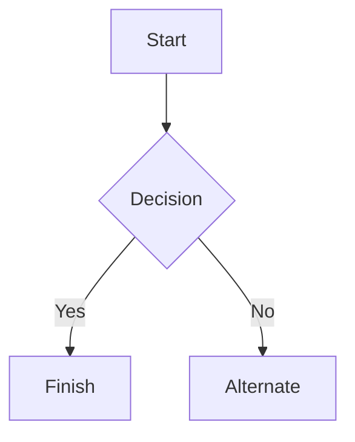

# Assignment 3- Creative Mode Feature Proposal

## REQ 3-The Drunken Tavern

The Farmer can visit the Drunken Tavern and accept one of three fantasy quest, each transforming a quest arena into different challenge. Completing a contract earns coins and experience points, while failing or abandoning a quest can introduce penalties such as mob spawning and other related stuff. Farmer who cannot afford the quest can instead challenge the bartender to a drinking contest, the downside is that he may receive a difficult quest if he wins.

## The Mechanics
### Tavern Quest System
The Farmer can travel between the inherited farm and the Drunken Tavern using connected doorways. The bartender provides an interactives dialogue system where the Farmer can ask about the quests, choose a quest or participate in a drinking content.

Three Quest are available:
| Quest         | Entry fee     | Coin reward |XP reward|Time limit|
| ------------- |:-------------:|:-----------:|:-------:|:--------:|
| The Cursed Forest      | 120     | 280             | 100         | 45 turns         |
| The Lost Survivors      | 200     | 450            | 160        | 55 turns          |
| The Ancient Relic      | 350     | 800            |  260       | 65 turns         |

Accepting a quest deducts the required coins and transport farmer to the Quest Arena. Each quest uses the same arena but generate different terrain, objectives, items and enemies.

The farmer must activate all required objectives before the contracts time limit expires.

Completing a quest reward the farmer with coins, experience and triggers chnages on the inherited farm. Abandoning a quest or exceeding the time limit will trigger consequences, this inslcude but not limited to hostile creature spawning and terrain corruption

The arena is reset between quest so it can be reused for different quest

### Drinking Contest
When a Farmer cannot afford at least one contract, the bartender provides the option to enter a drinking content

The content consists of three rounds, with two choices available for each round

| Sip  | Chug |
| ------------- |:-------------:|
| Safely drinks one cup      | Drinks two cups with a 20% chance of blacking out     |

The bartender drinks a randomly one or two drinks each round.

The farmer must finish with more cups than the bartender before blacking out. Winning frants entry to a randomly selected quest for free. Each quest has a set probability of being chosen with the hardest quest having a 15% rate of being chosen.

Losing or tying results in a 4 points stamina deduction and no quest is handed to you. Farmer is able to challenge the bartender again after 5 turn

## Architecture
Here we introduce two new interface and 6 brand new concrete classes with 3 concrete implementation for each interface

**Abstraction 1: QuestScenario**

Type: New interface

Responsibility: Defines how each cotract prepares the Quest Arena by placing specific terrain,objectives, items and enemies

**Concrete implementation:**

| Class  | Complex effect |
| ------------- |:-------------:|
| CursedForestScenario      | Transform multiple arena tiles into corrupted ground, creates three ritual root objectives and spawn hostile slime     |
| RescueMissionScenario      | right bar     |
| AncientRelicScenario      | right baz     |

# This is a Heading h1
## This is a Heading h2
###### This is a Heading h6

## Emphasis

*This text will be italic*  
_This will also be italic_

**This text will be bold**  
__This will also be bold__

_You **can** combine them_

## Lists

### Unordered

* Item 1
* Item 2
* Item 2a
* Item 2b
    * Item 3a
    * Item 3b

### Ordered

1. Item 1
2. Item 2
3. Item 3
    1. Item 3a
    2. Item 3b

## Images


## Links

You may be using [Markdown Live Preview](https://markdownlivepreview.com/).

## Blockquotes

> Markdown is a lightweight markup language with plain-text-formatting syntax, created in 2004 by John Gruber with Aaron Swartz.
>
>> Markdown is often used to format readme files, for writing messages in online discussion forums, and to create rich text using a plain text editor.

## Tables

| Left columns  | Right columns |
| ------------- |:-------------:|
| left foo      | right foo     |
| left bar      | right bar     |
| left baz      | right baz     |

## Blocks of code

```
let message = 'Hello world';
alert(message);
```

## Mermaid diagrams


## Inline code

This web site is using `markedjs/marked`.

## REQ 4 - Alchemy Valley

## The Pitch

Alchemy Valley is a new map, reached through a paid Wishing Well, where the farmer brews potions in three cauldrons. Brewing is not instant: the farmer loads ingredients (and must have enough XP), and the cauldron brews over several turns, changing the world around it while it works. When the potion is collected and drunk, it triggers a powerful effect such as knockback, damage reflection, or terrain-breaking item magnetism.

## The Mechanics

### Travel and the Wizard

A `WishingWell` on the farm map lets the farmer perform a `WishAction`. It costs 100 coins and teleports the farmer to Alchemy Valley. If the arrival tile is occupied, the wish fails and no coins are taken. A second well in Alchemy Valley (cost 0) returns the farmer to the farm. Wells and cauldrons are impassable furniture: the farmer uses them from an adjacent tile.

A Wizard NPC in Alchemy Valley tells the farmer each potion's ingredients, XP requirement and brewing time, and how much XP the farmer is still missing (zero once the requirement is met).

### Multi-turn Brewing

1. The farmer uses a `LoadAction` on a cauldron while holding the correct ingredients and enough XP. The ingredients are consumed and the brew timer starts.
2. Each turn the cauldron ticks down its timer and applies its own in-brew effect.
3. When the timer ends, the cauldron is marked READY. The farmer uses a `CollectAction` to take the potion. A cauldron cannot be loaded again until its potion has been collected.

XP is a threshold that is checked and not spent. It is earned through the quest and XP feature built by a teammate for REQ3. This feature only reads the XP value.

### Recipes

Three potions are available:

| Potion              | Ingredients                      | XP Required | Brew Time |
|---------------------|----------------------------------|:-----------:|:---------:|
| Gale Draught        | 3 Strawberry, 1 Tomato, 1 Copper |     50      |  3 turns  |
| Aegis Elixir        | 3 Stone, 2 Strawberry, 1 Diamond |     100     |  4 turns  |
| Prospector's Elixir | 2 Copper, 2 Tomato, 1 Stone      |     150     |  5 turns  |

### Potion Effects

Drinking reuses the existing `Consumable` and `ConsumeAction`.

* **Gale Draught:** AoE, radius 3. Every actor in range is pushed up to 3 tiles directly away from the farmer. Anything blocked by an obstacle or the map edge stops early. Hostile creatures hit this way are stunned for 2 turns.
* **Aegis Elixir:** Applies a reflect Status for 10 turns. While active, the farmer takes no damage, and the damage that was blocked is dealt to the creature that attacked. The engine does not tell a Status who the attacker was, so the attacker is identified from the adjacent hostile creatures: the one whose attack damage equals the blocked amount and which has not already been reflected onto that turn. If no creature matches, another adjacent hostile creature that has not yet been reflected onto takes the damage.
* **Prospector's Elixir:** AoE, radius 4. Every portable item on the ground in range is pulled into the farmer's inventory, and every Rock in range is shattered, replaced with Dirt, and leaves a Stone item on the ground on that tile, which changes the terrain.

### Cauldron Effects While Brewing

Each cauldron is linked to one potion and changes the world every turn of the brew.

* **Orchard Cauldron (brews Gale Draught, 3 turns):** Each turn it plants one `ArcaneSapling` on a random empty tile on the map (a Dirt tile with no actor and no item). A sapling grows over 3 turns into an `ArcaneTree`, even after the potion is collected. A tree cannot be walked through and drops a random Strawberry or Tomato on its tile every 2 turns. A hostile creature that steps onto a sapling tramples it and the previous ground is restored.
* **Taming Cauldron (brews Aegis Elixir, 4 turns):** Each turn it places one `Lure` item on a random empty tile on the map. Every hostile creature that is not already tamed drops its current behaviour and walks toward a random lure. When a creature reaches a lure, the lure is used up and the creature permanently gets a `TAMED` status: it stops attacking the farmer and instead attacks any untamed hostile creature it meets. Unused lures disappear when the potion is collected. This applies to every hostile creature, including the Zombie.
* **Quarry Cauldron (brews Prospector's Elixir, 5 turns):** When the brew starts it spawns a `StoneGolem` actor on a free tile next to the cauldron. Each turn the golem takes one step along the shortest path towards a random Rock on the map. When it is next to that Rock it shatters it: the Rock is replaced with Dirt and a Stone item is left on that same tile. The Stone is not given to the farmer or the cauldron; the farmer walks over and picks it up. The golem crumbles when the potion is collected.

### Controlling existing creatures without modifying them

Stun, lure-seeking and taming are applied from outside the existing creature classes. Stun and taming are `Status` objects, and their effects are behaviours added to the creature at a higher priority than its existing behaviours. The Zombie chooses its action from its own state machine and ignores behaviours, so the first time a Zombie is affected it is replaced by a `ControlledZombie` (a subclass of Zombie) on the same tile, with the same health, inventory, statuses and abilities. A `ControlledZombie` checks the control behaviours first and otherwise plays exactly like a Zombie.

### Type checks

The feature does not use `instanceof`. Hostile creatures are recognised through the engine's capability lookup (`asCapability`). Lures carry their own ability (`LURE`). Concrete terrain (Dirt, Rock) cannot use capabilities, so it is compared by exact class in one place only (`TileFinder`). The farmer's XP is read through a direct cast, which is safe because only the farmer can execute the load and wizard actions.

## The Architecture

### New Abstractions

| Abstraction      | Type           | Extends  |
|------------------|----------------|----------|
| `Potion`         | Abstract class | `Item`   |
| `BrewingStation` | Abstract class | `Ground` |

`Potion` holds the ingredient list, XP requirement, brew time, and a `drink` method that each potion implements. `BrewingStation` holds the brew timer, the IDLE / BREWING / READY state, the load and collect logic, and an abstract hook for the in-brew effect that each cauldron implements (plus optional hooks for when the brew starts and when the potion is collected).

### Concrete Classes

| #   | Class              | Implements / Extends | Status |
|-----|--------------------|----------------------|--------|
| 1   | `GaleDraught`      | `Potion`             | New    |
| 2   | `AegisElixir`      | `Potion`             | New    |
| 3   | `ProspectorElixir` | `Potion`             | New    |
| 4   | `OrchardCauldron`  | `BrewingStation`     | New    |
| 5   | `TamingCauldron`   | `BrewingStation`     | New    |
| 6   | `QuarryCauldron`   | `BrewingStation`     | New    |

All six concrete classes are entirely new. No classes from Assignments 1 to 3 are retrofitted.

### Supporting Classes

These are not counted towards the six.

* `WishingWell` (extends `Ground`) and `WishAction`: the travel mechanism.
* `Wizard` (extends `Actor`) and `RecipeInfoAction`: the recipe guide NPC and the action it offers for each potion.
* `LoadAction` and `CollectAction`: the farmer's actions at a cauldron.
* `AlchemyValleyWorld` (map): builds the new map containing the three cauldrons, the wizard, two hostile creatures and the return well. It is linked to the farm in `StackQueueValleyWorld`.
* `ArcaneSapling` and `ArcaneTree` (extend `Ground`), `Lure` (extends `Item`), `StoneGolem` (extends `NonPlayerCharacter`): what the cauldrons create.
* `StunStatus`, `TamedStatus`, `ReflectStatus` (implement `Status`) and `ReflectingHealth` (extends `BaseStatistic`): the effects.
* `CreatureControl`, `ControlledZombie` and `BehaviourHost`: apply stun, lure-seeking and taming to existing creatures.
* `TileFinder` (finds map tiles for the cauldrons) and `AlchemyAbility` (ability markers).

### Existing Classes Used (Unmodified)

`Item`, `Ground`, `Actor`, `Status`, `Consumable`, `ConsumeAction`, `Rock`, `Dirt`, `Zombie`, `HostileCreature`, `NonPlayerCharacter`, `Farmer`, `StoneItem`, `CopperItem`, `DiamondItem`, `StrawberryItem`, `TomatoItem`, `PortableResourceTransfer`, `FinanceStatistics`.

