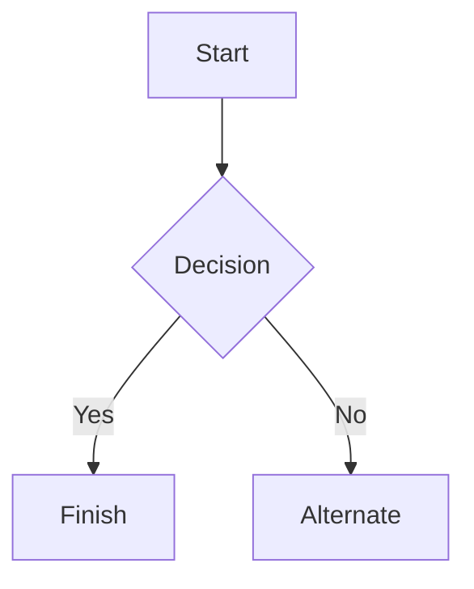

# Assignment 3- Creative Mode Feature Proposal

## REQ 3-The Drunken Tavern

The Farmer can visit the Drunken Tavern and accept one of three fantasy quest, each transforming a quest arena into different challenge. Completing a contract earns coins and experience points, while failing or abandoning a quest can introduce penalties such as mob spawning and other related stuff. Farmer who cannot afford the quest can instead challenge the bartender to a drinking contest, the downside is that he may receive a difficult quest if he wins.

## The Mechanics
### Tavern Quest System
The Farmer can travel between the inherited farm and the Drunken Tavern using connected doorways. The bartender provides an interactives dialogue system where the Farmer can ask about the quests, choose a quest or participate in a drinking content.

Three Quest are available:
| Quest         | Entry fee     | Coin reward |XP reward|Time limit|
| ------------- |:-------------:|:-----------:|:-------:|:--------:|
| The Cursed Forest      | 120     | 280             | 100         | 45 turns         |
| The Lost Survivors      | 200     | 450            | 160        | 55 turns          |
| The Ancient Relic      | 350     | 800            |  260       | 65 turns         |

Accepting a quest deducts the required coins and transport farmer to the Quest Arena. Each quest uses the same arena but generate different terrain, objectives, items and enemies.

The farmer must activate all required objectives before the contracts time limit expires.

Completing a quest reward the farmer with coins, experience and triggers chnages on the inherited farm. Abandoning a quest or exceeding the time limit will trigger consequences, this inslcude but not limited to hostile creature spawning and terrain corruption

The arena is reset between quest so it can be reused for different quest

### Drinking Contest
When a Farmer cannot afford at least one contract, the bartender provides the option to enter a drinking content

The content consists of three rounds, with two choices available for each round

| Sip  | Chug |
| ------------- |:-------------:|
| Safely drinks one cup      | Drinks two cups with a 20% chance of blacking out     |

The bartender drinks a randomly one or two drinks each round.

The farmer must finish with more cups than the bartender before blacking out. Winning frants entry to a randomly selected quest for free. Each quest has a set probability of being chosen with the hardest quest having a 15% rate of being chosen.

Losing or tying results in a 4 points stamina deduction and no quest is handed to you. Farmer is able to challenge the bartender again after 5 turn

## Architecture
Here we introduce two new interface and 6 brand new concrete classes with 3 concrete implementation for each interface

**Abstraction 1: QuestScenario**

Type: New interface

Responsibility: Defines how each cotract prepares the Quest Arena by placing specific terrain,objectives, items and enemies

**Concrete implementation:**

| Class  | Complex effect |
| ------------- |:-------------:|
| CursedForestScenario      | Transform multiple arena tiles into corrupted ground, creates three ritual root objectives and spawn hostile slime     |
| RescueMissionScenario      | right bar     |
| AncientRelicScenario      | right baz     |

# This is a Heading h1
## This is a Heading h2
###### This is a Heading h6

## Emphasis

*This text will be italic*  
_This will also be italic_

**This text will be bold**  
__This will also be bold__

_You **can** combine them_

## Lists

### Unordered

* Item 1
* Item 2
* Item 2a
* Item 2b
    * Item 3a
    * Item 3b

### Ordered

1. Item 1
2. Item 2
3. Item 3
    1. Item 3a
    2. Item 3b

## Images


## Links

You may be using [Markdown Live Preview](https://markdownlivepreview.com/).

## Blockquotes

> Markdown is a lightweight markup language with plain-text-formatting syntax, created in 2004 by John Gruber with Aaron Swartz.
>
>> Markdown is often used to format readme files, for writing messages in online discussion forums, and to create rich text using a plain text editor.

## Tables

| Left columns  | Right columns |
| ------------- |:-------------:|
| left foo      | right foo     |
| left bar      | right bar     |
| left baz      | right baz     |

## Blocks of code

```
let message = 'Hello world';
alert(message);
```

## Mermaid diagrams


## Inline code

This web site is using `markedjs/marked`.
